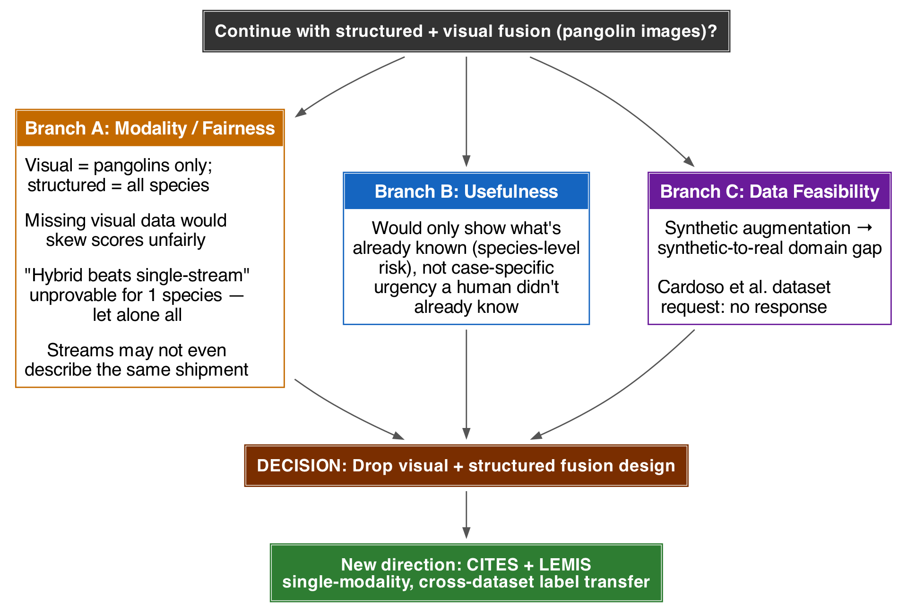
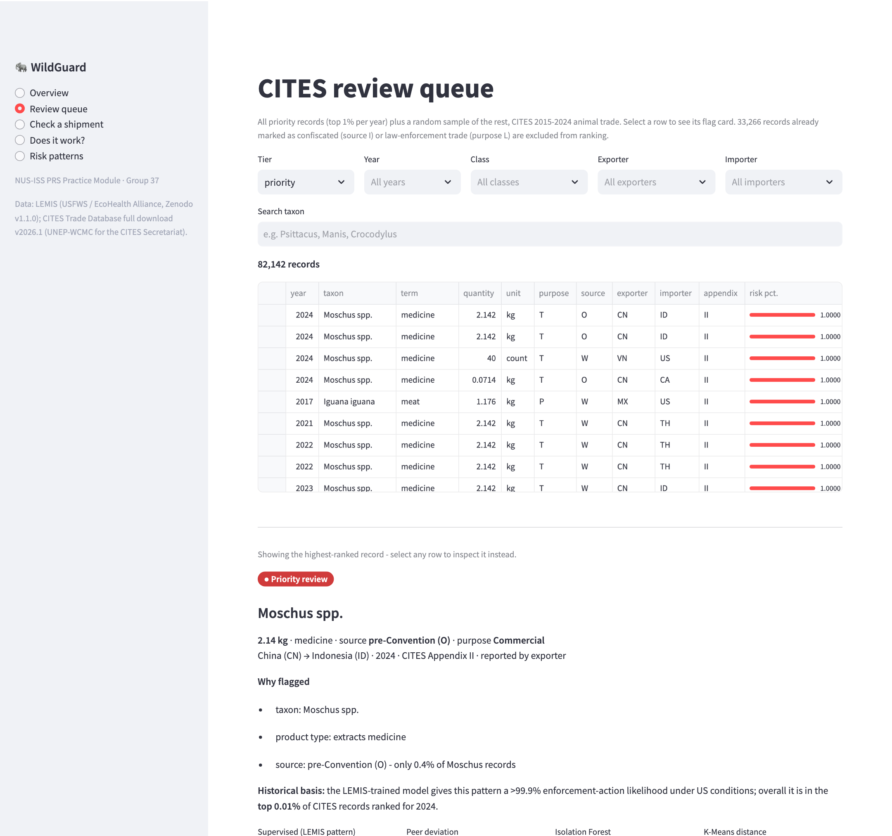
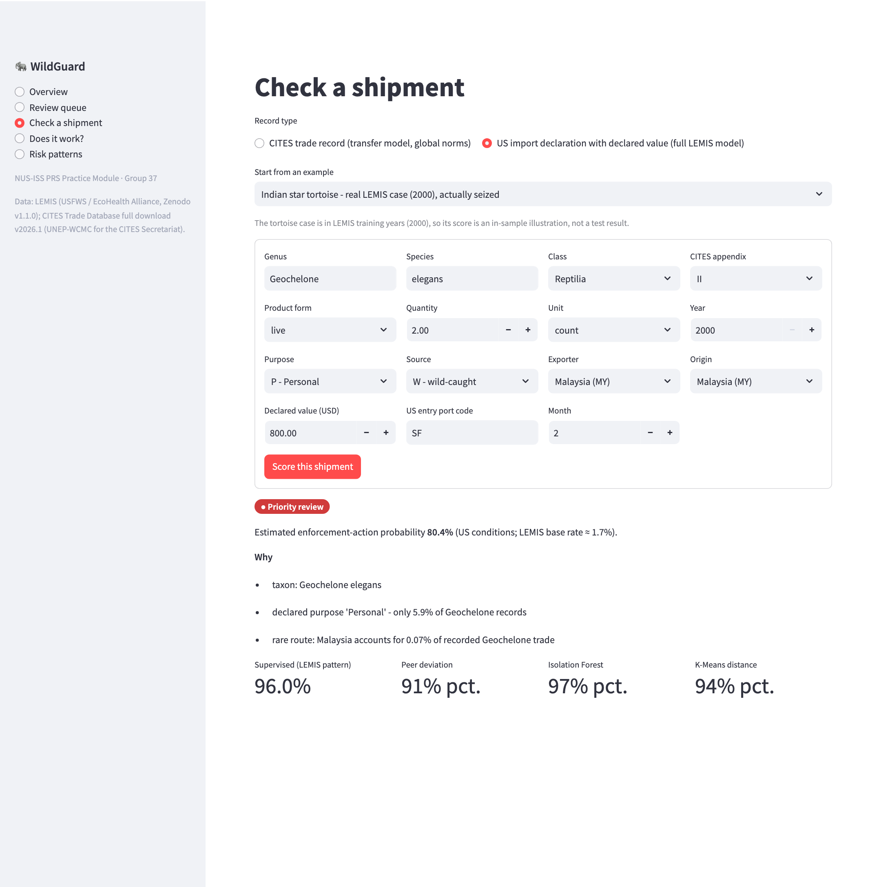
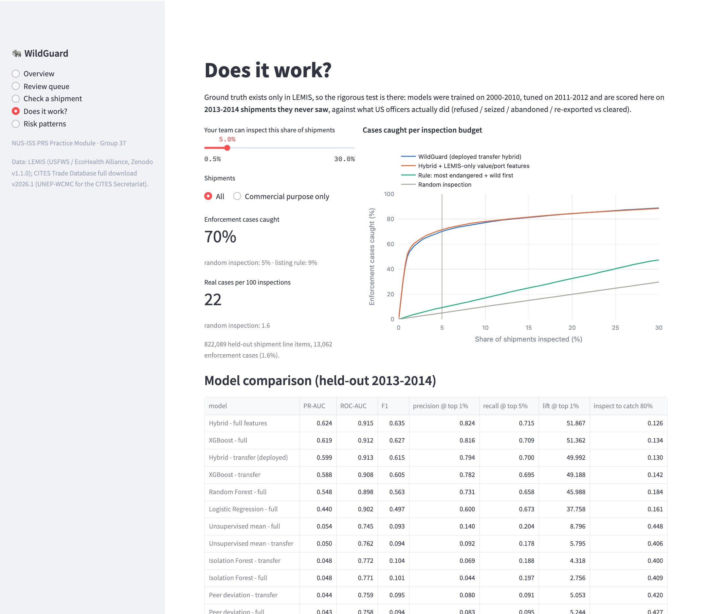
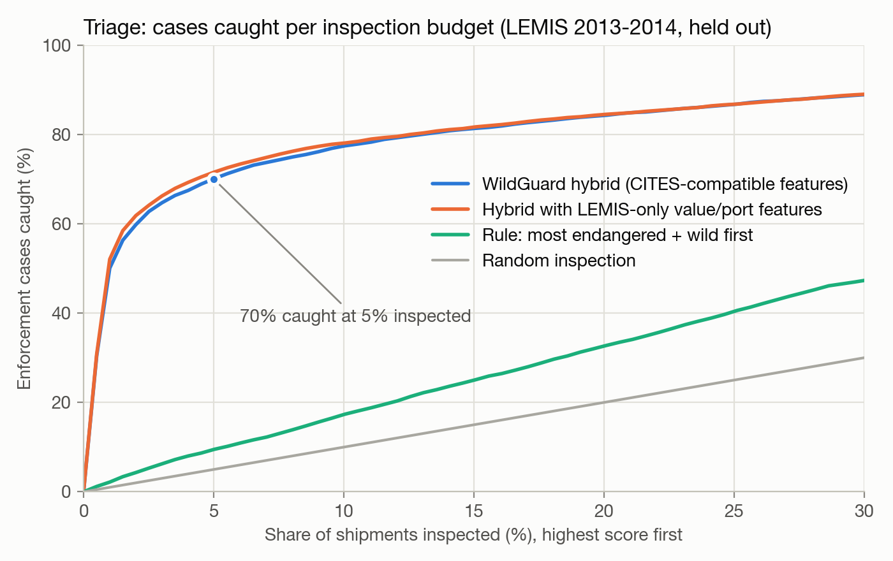
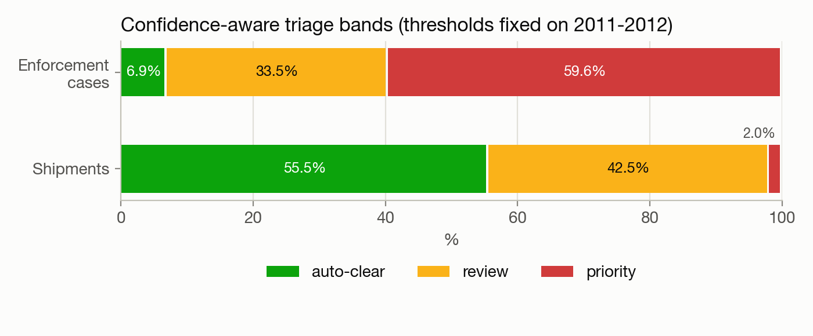
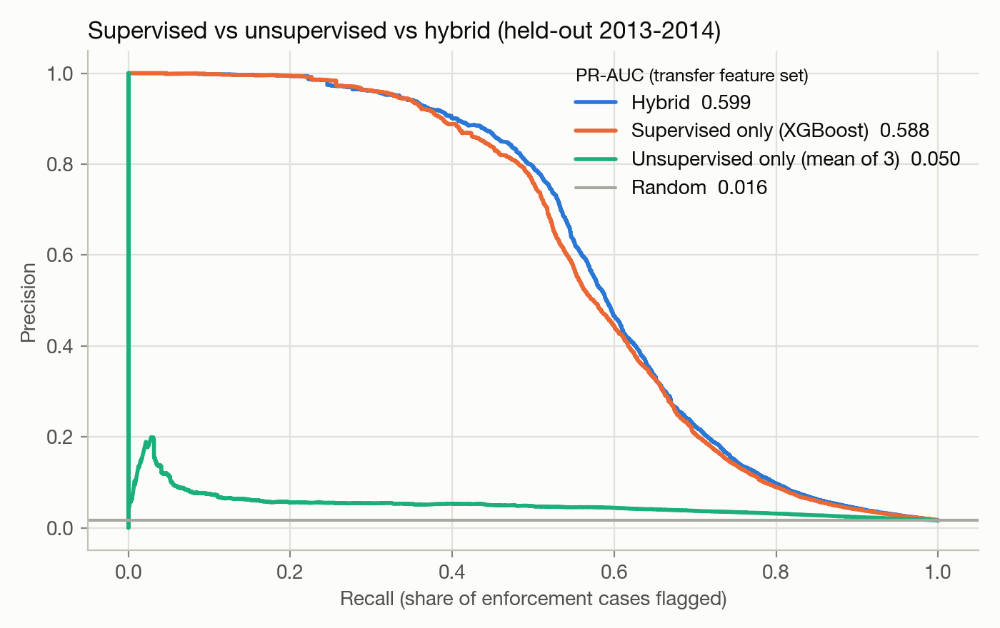
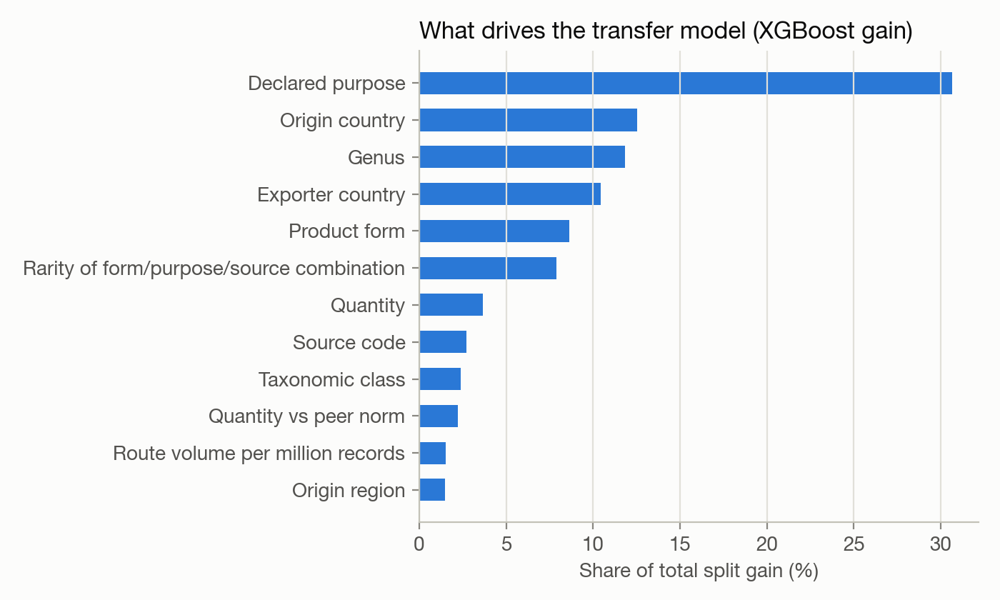
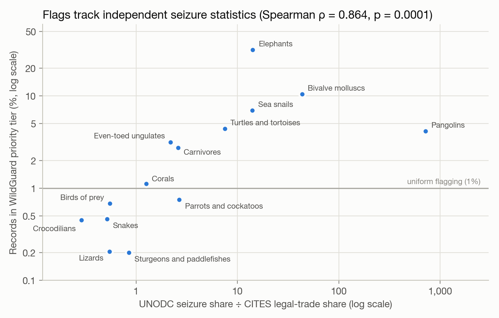

| Team member | Student ID | Role |
|---|---|---|
| Abinaya Muruganandam | A0181013X | Member |
| Adhithi Muruganandam | A0181014W | Team Leader |

# Executive summary

Wildlife trade is recorded at a scale no enforcement agency can inspect record by record: the
CITES Trade Database we used holds 29.2 million records since 1975, and roughly 800,000 new
animal-trade records are added each year. The signal that separates routine trade from trade
worth a closer look rarely sits in a single field. It sits in combinations of species, product
form, quantity, purpose, source and route, judged against what is normal for that species.

**WildGuard** is a pattern-recognition system that ranks wildlife-trade records for human
review. Its central idea is **cross-dataset label transfer**. The US Fish & Wildlife Service's
LEMIS data records what inspectors actually did with 5.5 million import line items between 2000
and 2014 (cleared, refused, seized, abandoned or re-exported). WildGuard learns the patterns that
preceded enforcement action there, and applies them to the much larger CITES database, which has
global coverage but no enforcement labels. To make this possible we built a knowledge model that
maps both datasets onto one shared schema.

The system combines a **supervised** gradient-boosted model trained on enforcement outcomes with
three **unsupervised** detectors (a peer-group deviation score, an Isolation Forest and K-Means
distance) through a **stacked hybrid** meta-learner. Every flag comes with plain-language reasons
derived from TreeSHAP contributions. A Streamlit application serves as the minimum viable product.

**Results on held-out data (LEMIS 2013–2014, never used for training or tuning):**

* With an inspection budget of **5% of shipments, WildGuard catches 70% of real
  enforcement cases** (random inspection: 5%; a "most endangered first" rule: 9%). 79% of
  its top-1% flags were real cases, against a 1.6% base rate.
* Catching 80% of enforcement cases requires inspecting **13% of shipments instead of
  80%**, an 84% reduction in inspection workload.
* PR-AUC is **0.599** against 0.016 for random inspection. The hybrid beats its supervised
  part (0.588), which beats unsupervised detection alone (0.050). Restricting the model to
  fields CITES also records costs only 4% of PR-AUC.
* Under a simulated regional shift the ranking holds up (ROC-AUC 0.900 → 0.892), and
  5% of target labels close 55% of the gap to a fully supervised target model.

**Results on CITES (no labels).** WildGuard ranks 8.2 million CITES animal-trade records (2015–2024) into review tiers, after setting aside 33,266 records already marked as confiscated. Flags concentrate in horn, ivory, shells, teeth and bone, in pre-Convention and unknown-source claims, and in taxa such as musk deer, whales, elephants, sea turtles and saiga. Two independent checks support the ranking without any CITES labels. First, species groups over-represented in UNODC seizure data relative to their legal trade are flagged more often (Spearman ρ = 0.864, p = 0.0001; the listing rule shows no such relationship). Second, a model that never sees the source field ranks CITES's confiscated-specimen records far above the rest (ROC-AUC 0.87).

The honest scope of the claim: a WildGuard flag means *this record resembles shipments that
historically drew enforcement action, or deviates sharply from normal trade for its species*. It
is a prompt for limited human attention, not evidence that a law was broken.

# 1. Introduction

## 1.1 The problem

International trade in wild animals and plants is regulated under the Convention on
International Trade in Endangered Species of Wild Fauna and Flora (CITES). Parties report their
permitted trade annually, and those reports are compiled by UNEP-WCMC into the CITES Trade
Database. The full download we used (version 2026.1) contains **29,170,051 records** from 1975 to
2026. Illegal trade is common enough that UNODC's *World Wildlife Crime Report 2024* analysed about
140,000 seizures across 162 countries over 2015–2021, involving around 4,000 species (UNODC,
2024).

Enforcement agencies cannot inspect everything. The CITES Secretariat and the World Customs
Organization developed *Guidance on Risk Assessment and Inspections for CITES Trade Controls*
(CITES Notification No. 2025/015). CoP20 decisions in December 2025 (Decisions 20.130–20.131)
encourage Parties to use and share experience with it. The guidance exists because inspection
resources must be targeted, but in most agencies that targeting is still a manual, officer-driven
process.

## 1.2 Why pattern recognition

Three properties make this a pattern-recognition problem rather than a reporting problem:

1. **Scale.** Hundreds of thousands of new records arrive each year, far beyond manual review.
2. **The signal is a pattern, not a field.** In February 2000 a shipment of two live, wild-caught
   Indian star tortoises (*Geochelone elegans*) arrived from Malaysia, declared as a personal
   import worth $800 (LEMIS control number 2000709917). On its own it looks unremarkable. Against
   its peers it does not: of the 1,063 wild-caught live *Geochelone* line items imported with a
   declared value in 2000–2014, 99% were commercial, typically 3–25 animals (median 10) at a
   median of $35 per animal. This one was personal-purpose and priced at $400 per animal, 11 times
   the median. Personal-purpose imports of live *Geochelone* were refused 32% of the time, against
   3.5% for commercial ones. This shipment was seized. Detecting such a case requires comparing
   each record with its peers across several fields at once.[^tortoise]

[^tortoise]: Our first presentation quoted peer figures (26 peer shipments of 19–250 animals at a
    median of $6) from an exploratory LEMIS sample. The figures here are recomputed on the full
    dataset.
3. **Labels exist, but in the wrong place.** The outcomes needed to learn what risk looks like
   exist in one national dataset (LEMIS) but not in the global one (CITES).

## 1.3 Objective and research questions

> **Objective:** use real enforcement outcomes recorded in one national wildlife-trade dataset
> (LEMIS) to build a statistically grounded system that ranks records for human review in the
> much larger, unlabelled global CITES database.

We framed the project around five questions, so that its value is measured rather than asserted:

| # | Question | Where it is answered |
|---|---|---|
| RQ1 | Does it work — can enforcement outcomes be predicted on shipments the model never saw? | §6.2 |
| RQ2 | Is it useful — how much inspection effort does it save compared with random or rule-based inspection? | §6.3 |
| RQ3 | Does combining supervised and unsupervised evidence help? | §6.4 |
| RQ4 | Does it transfer — what happens under distribution shift, and which adaptation steps help? | §6.6 |
| RQ5 | What does it surface in CITES, and is that plausible against independent evidence? | §6.7 |

## 1.4 What a flag means

WildGuard is a **triage aid**. The label it learns is an enforcement outcome. That outcome is
often a paperwork refusal, not proof of trafficking, and LEMIS reflects US enforcement
priorities. On CITES no ground truth exists, so the system *ranks* records within an inspection
budget instead of claiming calibrated probabilities. Every output is meant to be reviewed by a
person.

# 2. Project journey: from image fusion to label transfer

Our submitted proposal (15 September 2026) described a hybrid system that fused structured CITES
and seizure records with visual recognition of pangolin products. While preparing the first
presentation we re-examined that design and dropped it, for three groups of reasons
(Figure 1):

* **Modality and fairness.** The visual stream covered one species (pangolins); the structured
  stream covered all CITES taxa. Treating missing images as weaker evidence would systematically
  suppress scores for every non-pangolin case, and positive visual evidence would systematically
  inflate pangolin cases, independent of true risk. The two streams were not even guaranteed to
  describe the same shipment. Proving that "hybrid beats single-stream" would have been hard for
  one species and impossible across all of them. Published work on modality imbalance and
  "greedy" multimodal learning shows naive fusion can lose to the best single modality when one
  modality is sparse (Wang et al., 2020; Wu et al., 2022; Peng et al., 2022).
* **Usefulness.** The system would mostly have restated what is already known ("pangolins are
  heavily trafficked") rather than saying which *specific* record deserves attention now.
* **Data feasibility.** The candidate pangolin image datasets were available only on request; our
  request to Cardoso et al. received no response. Synthetic augmentation of a small seed set
  would have introduced a synthetic-to-real domain gap.

{width=95%}

The new direction keeps a single modality (structured trade records) and uses two large, real,
freely downloadable datasets that complement each other's gaps: **LEMIS has labels but only US
scope; CITES has global scope but no labels.** In our literature search we found no published
work that transfers LEMIS enforcement outcomes to CITES records. The closest precedent was an
informal analysis that applied LEMIS labels to commercial shipping records rather than to CITES.
The contribution is therefore an *application* of established techniques in a new combination,
not a new algorithm.

# 3. Data

## 3.1 Sources

| | LEMIS (US Fish & Wildlife Service) | CITES Trade Database |
|---|---|---|
| Content | Every wildlife import declared to USFWS | Trade in CITES-listed species, reported by all Parties |
| Version | Zenodo record 3565869, v1.1.0 (Eskew et al., 2019; 2020) | Full download v2026.1 (UNEP-WCMC) |
| Size | 5,512,706 import line items in 2,088,676 shipments | 29,170,051 records |
| Period used | 2000–2014 (all) | Animal records 2015–2024 for scoring (8,247,093); 2013–2014 US-reported records for the alignment check |
| Labels | `action` (Cleared/Refused), `disposition` (Cleared/Seized/Abandoned/Re-exported) | none |
| Declared value | yes (USD) | no |

Both datasets were checked for updates during the project. LEMIS v1.1.0 is the latest Zenodo
version and is a one-off release. CITES v2026.1 is the current annual bulk release; its most
recent years are incomplete because Parties report with a lag.

## 3.2 Label and class imbalance

A LEMIS line item is labelled an **enforcement case** if it was refused (`action = R`) or its
disposition was seized, abandoned or re-exported. This gives **95,665 positives (1.74%)**. Among
them, 53,030 were seized, 22,257 abandoned and 18,235 re-exported; the remainder were refused
with another or missing disposition. The positive rate is stable across years (1.5–2.2%), which
makes a temporal split meaningful. Labels are effectively shipment-level: only 1.0% of
multi-item shipments have mixed outcomes.

At a 1.7% positive rate, accuracy is uninformative: clearing everything scores 98.3%. We
therefore evaluate with ranking and budget metrics (§6.1).

## 3.3 What the raw data already says

| Group | Enforcement rate | Group | Enforcement rate |
|---|---|---|---|
| Purpose: personal (P) | 25.5% | Source: confiscated (I) | 74.6% |
| Purpose: commercial (T) | 0.98% | Source: unknown (U) | 25.6% |
| Purpose: hunting trophy (H) | 0.55% | Source: wild (W) | 1.76% |
| Product: caviar | 29.5% | Source: captive-bred (C) | 0.56% |
| Product: extracts / medicine | 28.0% | Appendix I species | 4.2% |
| Product: ivory | 12.0% | Appendix II species | 2.3% |
| Product: live animals | 0.52% | Not CITES-listed | 1.2% |

Half of all enforcement cases (49.6%) are personal imports, typically wildlife products in
travellers' luggage: wild-sourced personal "extracts/medicine" is refused 96% of the time.
Commercial imports account for 41.9% of cases. This matters for transfer, because CITES records
are overwhelmingly commercial (purpose T in 90.0% of 2015–2024 animal records; personal purpose in only 3.2%). We therefore also report
a commercial-only evaluation (§6.5).

## 3.4 Schema alignment — the knowledge model

LEMIS and CITES describe the same kind of event in different vocabularies. We built an explicit
crosswalk (`schema_alignment.py`):

| Field | LEMIS | CITES | Shared form |
|---|---|---|---|
| Product form | 94 three-letter codes (`LIV`, `SKI`, `IVC` …) | 101 English terms (`live`, `skins` …) | 31 product groups (live vs dead, raw vs worked; ivory, horn and bone kept apart) |
| Unit | `NO`, `KG`, `GM`, `ML` … | `kg`, `g`, blank = number … | count / kg / litre / m / m² / m³, quantities converted |
| Source, purpose | CITES letter codes | CITES letter codes | identical (unmapped → `unknown`) |
| Country | ISO-3166 alpha-2 | ISO-3166 alpha-2 | identical, plus world region |
| Taxonomy | genus, species, class | taxon, genus, family, order, class | genus, class (*Actinopterygii* ↔ *Actinopteri*) |
| CITES appendix | not recorded | recorded | looked up for LEMIS taxa from CITES (species, then genus) |
| Declared value | USD | — | used only by the LEMIS-only "full" model |

After mapping, only 0.5% of LEMIS and 0.03% of CITES animal records fall into the residual
`other` product group. The alignment was checked empirically with a domain classifier and the
population stability index (§6.6 B).

# 4. System design

## 4.1 Architecture

{width=100%}

The pipeline is implemented as a Python package (`SYSTEM CODE/wildguard/`) and runs end to end
with one script (`run_pipeline.sh`). DuckDB streams the ~6 GB of raw CSV into aligned Parquet
files; all modelling uses pandas, scikit-learn and XGBoost.

## 4.2 Relative risk features

The worked tortoise example shows that risk lies in *deviation from a record's peers*. Most
features are therefore relative, and relative features also transfer better across datasets than
absolute ones. "Ten times the usual quantity for this species and product" means the same in
LEMIS and CITES even though their absolute volumes differ.

| Feature | Definition |
|---|---|
| `qty_z` | Robust z-score of log quantity within the peer group (genus × product group × unit), using median and MAD; backs off to class level for groups under 20 records |
| `unit_value_z` (LEMIS only) | Robust z-score of log declared value per unit within the peer group |
| `route_share`, `route_n_log` | Share of the genus's records exported by this country; route volume per million records |
| `combo_rarity` | −log₁₀ frequency of the product × purpose × source combination |
| `purpose_share_in_genus`, `source_share_in_genus` | How common this purpose / source is for this genus |
| `peer_n_log` | Size of the peer group, per million records (thin groups are less certain) |
| `reexport_flag`, `is_wild` | Origin ≠ exporter; source = wild |
| Categorical | class, product group, unit group, purpose, source, CITES appendix, origin/exporter region, top-300 genus, top-120 origin and exporter countries |

Peer norms are always learned from a *reference population*: the LEMIS training years when
training, or CITES itself when scoring CITES. The genus and country vocabulary always comes from
the training data. Counts are expressed per million records so that they mean the same thing in
populations of different size.

Two feature sets are trained in parallel:

* **Full**: all features, including LEMIS-only declared value, unit value, entry port and month.
* **Transfer**: only fields that also exist in CITES. This is the model deployed on CITES.

## 4.3 Supervised learning

* **XGBoost** (gradient-boosted trees; histogram method with native categorical support, depth
  8, learning rate 0.08, row/column subsampling 0.8, `scale_pos_weight` = √(neg/pos) ≈ 7.5).
  Early stopping on validation PR-AUC selected 326 (transfer) and 227 (full) boosting rounds.
* **Random Forest** (300 trees, depth 18, balanced class weights, 600k-row subsample) and
  **Logistic Regression** (one-hot plus standardised numerics, balanced weights) as comparison
  models.

## 4.4 Unsupervised learning

Three detectors score how anomalous a record is **without using labels**, so they can be fitted on
any unlabelled stream, including CITES:

* **Peer-deviation score**: a transparent statistical score that averages the capped |qty_z|,
  route rarity, combination rarity and purpose/source rarity (plus |unit_value_z| in the full
  variant).
* **Isolation Forest**: 200 trees on the deviation features, fitted on a 300k-record sample.
* **K-Means distance**: trade profiles are clustered with MiniBatch K-Means. k is chosen from
  {4, 6, 8, 10, 12} by silhouette score and checked for stability with the adjusted Rand index
  between two independent fits. The anomaly score is the distance to the nearest centroid divided
  by that cluster's 95th-percentile distance. The selected k was 12 (transfer features) and 10 (full features).

Each detector's raw score is mapped to a percentile within its own reference population, so
detectors fitted on different datasets share one 0–1 scale.

## 4.5 Hybrid stacking

A logistic-regression meta-learner combines four inputs: the supervised logit and the percentile
ranks of the three detectors. It is fitted on the **validation years (2011–2012)** only, so it
never sees the training data's in-sample predictions or the test years. Its output is the
WildGuard risk score. Learned weights for the transfer stack: supervised logit 0.85, Isolation Forest 1.18, peer deviation 0.36, K-Means 0.01.

## 4.6 Explanations

For every flagged record, XGBoost's exact per-feature contributions (TreeSHAP,
`pred_contribs`) identify the inputs that pushed the risk up. The top three are turned into
plain-language reasons that an analyst can check against the record. For the tortoise shipment
of §1.2 these are *"declared purpose 'Personal' – only 5.9% of Geochelone records"* and *"rare
route: Malaysia accounts for 0.07% of recorded Geochelone trade"*. Country codes, purposes and
sources are rendered with their codebook names.

## 4.7 Deployment on CITES

1. CITES 2015–2024 animal records (8,247,093 records) are mapped with the same crosswalk.
2. Peer norms are re-learned from CITES itself (no labels needed), with the vocabulary fixed to
   the training data's.
3. The LEMIS-trained supervised model scores each record; the three detectors are re-fitted on
   CITES, so "anomalous" means anomalous relative to global CITES trade.
4. The LEMIS-fitted meta-learner combines the four signals. The deployed supervised model is the
   unweighted transfer model; an importance-weighted variant was tested and rejected (§6.6 C).
5. Records that are already enforcement material are set aside: source "I" (confiscated or
   seized specimen) or purpose "L" (law enforcement / judicial / forensic). Telling an analyst
   to review what has already been seized adds nothing. In an early run these records filled a
   fifth of the priority tier.
6. The remaining records are ranked **within each year** into tiers by inspection budget:
   **priority** = top 1%, **review** = next 4%, **routine** = the rest. Without CITES labels the
   score cannot be calibrated as a probability, so budget-based tiers are the defensible output.

## 4.8 MVP: the WildGuard review tool

The Streamlit application (`SYSTEM CODE/app/app.py`) runs from a clone of the repository without
the raw data. Its five pages:

| Page | Purpose |
|---|---|
| Overview | What the system does, headline results, what a flag means and does not mean |
| Review queue | CITES records ranked for review with filters; each opens a flag card with the record, reasons and the four underlying signals |
| Check a shipment | Scores any record, either as a CITES record (transfer model) or as a US import declaration with value (full model). Includes the real Indian star tortoise case as a preset |
| Does it work? | An inspection-budget slider over held-out LEMIS shipments: cases caught against random and rule-based inspection, plus the model comparison, triage bands and domain-shift results |
| Risk patterns | Where flagged CITES trade concentrates, and the UNODC consistency check |

{width=95%}

{width=95%}

{width=95%}

# 5. Tools and techniques

| Area | What we used | Module aspect |
|---|---|---|
| Data engineering | DuckDB (streaming SQL over 6 GB of CSV), pandas, PyArrow / Parquet | — |
| Knowledge modelling | LEMIS ↔ CITES crosswalk (product, unit, source, purpose, country, appendix) | Sense making |
| Feature engineering | Robust peer-group statistics (median/MAD z-scores), rarity and share features | — |
| Supervised learning | XGBoost, Random Forest, Logistic Regression; temporal split; early stopping | Supervised learning; ML techniques |
| Unsupervised learning | Peer-deviation score, Isolation Forest, K-Means (silhouette selection, ARI stability) | Unsupervised learning; ML techniques |
| Hybrid / ensemble | Boosted and bagged tree ensembles; stacked logistic meta-learner over supervised and unsupervised signals | Hybrid ML / ensemble |
| Transfer / domain adaptation | Feature re-normalisation, domain classifier, importance weighting, few-shot target labels | Hybrid ML |
| Evaluation | PR-AUC, ROC-AUC, F1 at validation-fixed thresholds, precision/recall at inspection budgets, capture curves, confidence bands, PSI | — |
| Sense making | TreeSHAP explanations, triage tiers, risk-pattern analytics, UNODC consistency check (Spearman) | Sense making |
| Application | Streamlit, Plotly, Matplotlib | — |
| Tooling | Python 3.11, scikit-learn 1.5, XGBoost 2.1, SciPy, joblib, Git/GitHub | — |

The project develops, integrates and demonstrates the first three required aspects
(supervised/unsupervised learning, machine-learning techniques, hybrid/ensemble). The
explanation and triage layer adds a sense-making component on top.

# 6. System performance

## 6.1 Evaluation protocol

* **Temporal split.** Train on 2000–2010 (3,877,130 line items), tune thresholds and fit the
  meta-learner on 2011–2012 (813,487), and report on 2013–2014 (822,089, positive rate
  1.59%). The test years are never used for fitting, peer statistics, thresholds or model
  selection.
* **Metrics.** PR-AUC (the headline ranking metric under imbalance) and ROC-AUC. Precision,
  recall and F1 are computed at a threshold fixed on the validation years. Budget metrics answer
  an inspector's question: precision and recall when inspecting the top 1%, 5% or 10%, lift over
  random, and the share of shipments that must be inspected to catch 50% or 80% of cases.
* **Baselines.** Random inspection, and a "most endangered first" listing rule (Appendix I, then
  Appendix II/III, wild-sourced first) that represents an obvious manual heuristic.

## 6.2 Main results (RQ1)

| Model | Features | PR-AUC | ROC-AUC | F1 † | Precision @ top 1% | Recall @ top 5% | Inspect to catch 80% |
|---|---|---|---|---|---|---|---|
| Random inspection | — | 0.016 | 0.501 | 0.031 | 1.6% | 5.1% | 79.7% |
| Listing rule (most endangered, wild first) | appendix, source | 0.024 | 0.605 | 0.048 | 3.4% | 9.5% | 70.6% |
| K-Means distance | transfer | 0.023 | 0.616 | 0.046 | 2.1% | 8.8% | 64.5% |
| Peer-deviation score | transfer | 0.044 | 0.759 | 0.095 | 8.0% | 9.1% | 42.0% |
| Isolation Forest | transfer | 0.048 | 0.772 | 0.104 | 6.9% | 18.8% | 40.0% |
| Unsupervised mean (3 detectors) | transfer | 0.050 | 0.762 | 0.094 | 9.2% | 17.8% | 40.6% |
| Logistic Regression | full | 0.440 | 0.902 | 0.497 | 60.0% | 67.3% | 16.1% |
| Random Forest | full | 0.548 | 0.898 | 0.563 | 73.1% | 65.8% | 18.4% |
| XGBoost | transfer | 0.588 | 0.908 | 0.605 | 78.2% | 69.5% | 14.2% |
| XGBoost | full | 0.619 | 0.912 | 0.627 | 81.6% | 70.9% | 13.4% |
| **Hybrid — deployed** | **transfer** | **0.599** | 0.913 | 0.615 | 79.4% | 70.0% | 13.0% |
| Hybrid | full | 0.624 | 0.915 | 0.635 | 82.4% | 71.5% | 12.6% |

: Table 1 – Held-out results, LEMIS 2013–2014 (822,089 line items, 1.59% enforcement cases). † F1 at the threshold that maximised F1 on the validation years. *full* = includes LEMIS-only declared value, unit value, port and month; *transfer* = only fields that also exist in CITES.

**Every learned model beats both baselines by a wide margin, and the deployed transfer hybrid
is close to the best model.** The deployed hybrid reaches a PR-AUC of 0.599, against
0.016 for random inspection: a 38-fold improvement in the
metric that matters under imbalance. The ordering is consistent across metrics: hybrid >
XGBoost > Random Forest > Logistic Regression > unsupervised detectors > listing rule > random.

Three findings stand out:

* **The obvious manual heuristic barely works.** Inspecting the most endangered, wild-caught
  species first gives a PR-AUC of 0.024, only 1.5× random. Listing status
  alone is not the risk signal; the *combination* of fields is. This is the core argument for a
  pattern-recognition approach.
* **Transfer costs little.** Restricting the model to CITES-compatible fields (dropping declared
  value, unit value, port and month) lowers PR-AUC from 0.624 to 0.599
  (4% relative). Most of the predictive signal lives in fields both datasets share.
* **Gradient boosting wins clearly.** XGBoost outperforms Random Forest (0.619
  vs 0.548) and Logistic Regression (0.440) on the
  same full feature set, as expected for heterogeneous tabular data with many interacting categories.

## 6.3 Usability: what an inspection budget buys (RQ2)

{width=85%}

| Strategy | Top 1%: caught (precision) | Top 5%: caught (precision) | Top 10%: caught (precision) | Inspect to catch 50% | Inspect to catch 80% |
|---|---|---|---|---|---|
| **WildGuard (deployed)** | 50.0% (79.4%) | 70.0% (22.3%) | 77.4% (12.3%) | 1.0% | 13.0% |
| Listing rule | 2.2% (3.4%) | 9.5% (3.0%) | 17.3% (2.7%) | 32.7% | 70.6% |
| Random inspection | 1.0% (1.6%) | 5.1% (1.6%) | 10.2% (1.6%) | 50.1% | 79.7% |

: Table 2 – What an inspection budget buys (held-out 2013–2014). "Caught" = share of all enforcement cases found within the budget; precision = share of inspected line items that were enforcement cases.

Framed as an inspector's decision, the result is concrete. **With a 5% inspection budget,
WildGuard finds 70% of all enforcement cases, 13.7× more than random inspection.**
Catching 80% of cases requires inspecting 13.0% of shipments instead of
79.7%: an 84% reduction in inspection workload for the same coverage. At the very top of
the ranking, 100% of the 100 highest-scored held-out line items and 99.9% of
the top 1,000 were real enforcement cases. By outcome type, the 5% budget catches 81% of
seizures, 86% of abandonments but only 42% of re-exports. Re-exports are often
paperwork problems with otherwise ordinary shipments, so they are harder to recognise from the
declaration alone.

Following the confidence-aware design, the hybrid score is also cut into three bands, with
thresholds fixed on the validation years (Figure 7). The **auto-clear** band holds
55.5% of shipments but only 6.9% of enforcement cases (an enforcement
rate of 0.20%). The **priority** band holds 2.0% of shipments and
59.6% of cases, with nearly one in two priority line items (47.8%) being a real
case. The **review** band in between (42.5% of shipments, 33.5% of cases)
is where human judgement is spent.

{width=80%}

## 6.4 Does combining supervised and unsupervised evidence help? (RQ3)

{width=85%}

**Combining evidence helps, modestly but consistently.** On the transfer feature set the hybrid
improves PR-AUC from 0.588 (XGBoost alone) to 0.599, and cuts the inspection needed
for 80% recall from 14.2% to 13.0%. The full feature set shows the same direction
(0.619 → 0.624). The gain appears mainly in the middle of the precision–recall curve
(recall 0.4–0.65, Figure 8), where the supervised model starts to lose precision and anomaly
evidence separates the remaining cases.

**Unsupervised detection alone is weak, and that is itself a finding.** The three detectors
together reach a PR-AUC of 0.050 (3.1× random), and their top 10% contains
33% of cases (random: 10%). They clearly detect *something*. But a great deal of
legal trade is statistically unusual (rare species, one-off scientific shipments, unusual
quantities), so **unusual is not the same as illegal**. This is exactly why the labels transferred
from LEMIS matter.

The meta-learner's weights on standardised inputs show which evidence it trusts: supervised
logit 0.85, Isolation Forest 1.18, peer deviation 0.36 and K-Means
0.01. K-Means contributes nothing beyond the other detectors. Its silhouette scores were modest
(0.30 at the selected k = 12 for the transfer features; 0.28 at k = 10 for the full set), and
its assignments were only moderately stable between independent fits (adjusted Rand index
0.65 and 0.81). Trade profiles form overlapping groups rather than well-separated
clusters, so distance to a centroid is a blunt anomaly measure. The Isolation Forest, which
isolates individual points rather than modelling cluster shape, is the more useful detector.

**What the model relies on** (Figure 9). Declared purpose carries 31% of the split gain,
followed by origin country (13%), genus (12%), exporter country
(10%), product form (9%) and the rarity of the product/purpose/source combination
(8%). The model has learned contextual risk: what is declared, for which species,
and from where, relative to the norm. Quantity deviations add further signal mainly through the
anomaly detectors.

{width=75%}

## 6.5 Robustness checks

| Subset | Base rate | WildGuard PR-AUC | Lift over random | Recall @ top 5% | Precision @ top 1% | Listing rule PR-AUC |
|---|---|---|---|---|---|---|
| All line items (headline) | 1.59% | 0.599 | 38× | 70.0% | 79.4% | 0.024 |
| Commercial purpose only | 0.82% | 0.276 | 34× | 51.6% | 26.5% | 0.012 |
| Personal purpose only | 25.60% | 0.910 | 4× | 19.5% | 100.0% | 0.314 |
| Shipment level (293,689 shipments) | 2.93% | 0.705 | 24× | 73.0% | 97.2% | 0.042 |

: Table 3 – Robustness of the deployed transfer hybrid on held-out 2013–2014 data. Lift over random = PR-AUC ÷ base rate. Shipment level: each shipment scored by its highest line-item score and labelled positive if any line item was an enforcement case.

* **Commercial shipments are harder, but the signal holds.** Commercial imports carry only
  0.82% enforcement cases, and the personal-luggage pattern that dominates LEMIS is absent. Even
  so, the deployed model reaches a PR-AUC of 0.276, 34 times random. Its top 5% of
  commercial line items contains 52% of commercial enforcement cases, against
  8% for the listing rule. Because CITES is 90% commercial, this is the most realistic estimate of
  how the ranking behaves on CITES-like trade. The full model, with declared value, reaches
  0.335 here: value matters more for commercial trade.
* **Personal imports are almost solved** (PR-AUC 0.91 at a 26% base
  rate). Personal imports account for 50% of held-out enforcement cases, which explains
  much of the headline precision.
* **Shipment-level results are stronger, not weaker.** Aggregating line items to shipments
  gives a PR-AUC of 0.705, and 97% of the top 1% of shipments were
  enforcement cases. Multi-item shipments therefore do not inflate the line-item results.
* **Stable over time, with mild drift.** PR-AUC is 0.620 on 2013 and 0.579
  on 2014. The gentle decline with distance from the training years suggests periodic retraining.
* **Reasonably calibrated where it matters.** In the highest decile of predicted risk the mean
  predicted probability is 14.7% and the observed enforcement rate 12.3%
  (Brier score 0.0090). On LEMIS the hybrid output can be read as an
  approximate probability, which is why the confidence bands work. On CITES it is used only as a
  ranking.
* **Worked example.** The Indian star tortoise shipment from §1.2 (a training-year record,
  so an illustration rather than a test) receives a hybrid score of 0.62 from the transfer model.
  That is higher than 99.2% of held-out line items. The top reasons
  given are: *declared purpose 'Personal' - only 5.9% of Geochelone records*, *rare route: Malaysia accounts for 0.07% of recorded Geochelone trade*, and its taxon. The highest-ranked
  held-out enforcement cases are equally recognisable, for example musk-deer medicine from China
  (seized and abandoned), sea-turtle eggs from El Salvador (seized) and iguana meat carried from
  Mexico as a personal import (seized).

## 6.6 Transfer robustness (RQ4)

CITES has no labels, so transfer *to CITES* cannot be scored directly. We therefore answer RQ4
with three complementary experiments (`domain_shift.py`).

**A. A simulated shift that can be scored.** We held out an entire region. The model was trained
without any shipments exported from Asia and tested on held-out shipments exported from
Asia, where labels exist. Several adaptation strategies were compared on the same target
test set (Table 4).

| Condition | Target labels used | PR-AUC | ROC-AUC | Recall @ top 5% | Lift @ top 1% |
|---|---|---|---|---|---|
| In-domain reference (non-Asian test shipments) | — | 0.592 | 0.900 | 67.6% | 46.9× |
| Naive transfer (source peer norms) | 0 | 0.539 | 0.892 | 65.7% | 50.9× |
| Re-normalised transfer (target norms, no labels) | 0 | 0.528 | 0.887 | 63.7% | 49.1× |
| Importance-weighted + re-normalised | 0 | 0.546 | 0.900 | 67.2% | 51.2× |
| + 1% of target labels | 15,994 | 0.542 | 0.911 | 70.6% | 45.5× |
| + 5% of target labels | 79,973 | 0.582 | 0.919 | 71.0% | 50.7× |
| Target oracle (all target labels) | 1,599,477 | 0.616 | 0.929 | 74.1% | 54.3× |

: Table 4 – Simulated domain shift. Trained on shipments exported from outside Asia (2,277,653 line items, 2000–2010); tested on held-out 2013–2014 shipments exported from Asia (333,542 line items, 1.31% enforcement cases). The in-domain row is tested on non-Asian 2013–2014 shipments (1.78% enforcement cases).

1. **Learned patterns survive a regional shift with modest loss.** ROC-AUC falls only from
   0.900 to 0.892, and lift at the top 1% does not fall at all
   (47× in-domain vs 51× transferred). Much of the PR-AUC drop
   (0.592 → 0.539) reflects the target's lower base rate rather than worse ranking.
2. **Re-normalising peer norms did not help on its own** (0.528 vs 0.539). Within
   LEMIS every shipment enters the same country under the same reporting system, so the source
   norms already describe the target well. We report this as a negative result.
3. **Importance weighting gave the best label-free transfer.** A domain classifier separates
   source from target with AUC 0.95 on raw fields; its odds p(target|x)/p(source|x),
   clipped to [0.05, 20], re-weight the training rows (effective sample size 10%). The
   weighted model reaches PR-AUC 0.546 and restores ROC-AUC to the in-domain level
   (0.900). It beats the best unweighted variant on every metric, so it passed our pre-specified
   deployment rule (an improvement of more than 0.005 PR-AUC over the best label-free option).
   The margin is small.
4. **A few target labels matter more than any label-free trick.** Adding 5% of the target's
   labels (79,973 line items, one twentieth of the oracle's) lifts PR-AUC to
   0.582, closing 55% of the gap between naive transfer and a fully supervised
   target model (0.616). This is the most practical lever for a real deployment: a
   small sample of reviewed CITES records would be worth more than further adaptation methods.

**B. How different is CITES from LEMIS?** We measured the shift in three ways (Table 5).

| Comparison | Domain-classifier AUC (raw fields) |
|---|---|
| LEMIS, CITES-listed taxa vs CITES records reported by the US for the same years (2013–2014) | 0.771 |
| LEMIS, all taxa vs the same US-reported CITES records | 0.908 |
| LEMIS vs global CITES 2015–2024 (the deployment shift) | 0.967 |

: Table 5 – How separable LEMIS and CITES records are (0.5 = indistinguishable, 1.0 = perfectly separable).

* **The alignment works where it should.** The US compiles its CITES annual report from the same
  kind of declarations LEMIS holds. Restricted to CITES-listed taxa, the two are only moderately
  distinguishable (AUC 0.77). Their purpose and exporter-region distributions are almost
  identical (population stability index 0.04 and 0.08; values below 0.1 are
  conventionally negligible). Remaining differences lie mainly in product form (PSI
  0.66), class (0.27) and appendix (0.31). These reflect LEMIS's finer product coding and the
  fact that CITES aggregates trade per permit and taxon.
* **The deployment shift is large and real.** Against global CITES 2015–2024 the AUC is
  0.97. The biggest differences are in CITES appendix (PSI 5.4; 58% of LEMIS
  concerns species not listed by CITES at all), taxonomic class (2.1) and product
  form (2.0); purpose (0.28) and source (0.16) shift much less.
* **Quantities sit on the same scale.** Under LEMIS peer norms, the median quantity z-score is
  0.00 for LEMIS test records, 0.00 for US-reported CITES records and
  -0.15 for global CITES. The share above +3 is 1.5%,
  0.9% and 2.7%. There is no systematic aggregation offset that the
  quantity features would misread.

*A methodological lesson.* Our first domain classifiers used every model feature and separated
every pair of populations perfectly (AUC 1.000), even two samples that should look almost alike.
The cause was **fingerprinting**: group-level statistics such as a route's share of a genus's
trade take one exact value per group within each population, so a tree model recognises the
population from those values rather than from any real difference in trade. That also made the
importance weights degenerate. Restricting domain classifiers to raw fields fixed both problems.
We report this because it would silently invalidate a shift analysis.

**C. Should the deployed model be importance-weighted?** Experiment A favoured importance
weighting, so we trained a transfer model importance-weighted toward CITES 2015–2024. The domain
classifier separates LEMIS training records from CITES records with AUC 0.984, so the
reweighting is strong (effective sample size 5.1%). It concentrates learning on LEMIS trade that
resembles CITES trade, at some cost on LEMIS-specific trade such as non-listed species and
personal luggage: on *all* held-out LEMIS records the weighted hybrid scores PR-AUC 0.566,
against 0.599 for the unweighted transfer hybrid. Before deploying it we checked the population
that matters most: held-out LEMIS records of **CITES-listed taxa** (335,447 line items), the LEMIS
records that most resemble CITES records. There, importance weighting *lowered* PR-AUC from 0.630
to 0.600 (precision at the top 1%: 94.4% → 92.0%).
Importance weighting therefore passed the regional test in experiment A but failed this more
relevant one. Our deployment rule requires both, so **the deployed CITES model is the unweighted
transfer stack**. The lesson is that importance weighting is not a free improvement. When the
domains overlap as little as LEMIS and CITES do (effective sample size 5.1%), the weights
throw away more information than they correct. Domain adaptation has to be evaluated on a
population that resembles the deployment target, not only on the simulation that motivated it.

## 6.7 Applying WildGuard to CITES (RQ5)

**Scale.** WildGuard scored all 8,247,093 CITES animal-trade records for 2015–2024.
33,266 records already marked as confiscated (source I) or law-enforcement trade (purpose L)
were set aside, since flagging what has already been seized adds nothing. The remaining
8,213,827 records were ranked within each year: 82,142 priority and 328,554
review records, about 8,200 priority records a year worldwide. The K-Means detector, re-fitted on
CITES, chose k = 10 (silhouette 0.31, stability ARI 0.70).

**Where the priority tier concentrates.** Uniform flagging would put every group at 1%.

| Product form | Records in priority tier |
|---|---|
| horn | 53.8% |
| shells | 35.2% |
| ivory | 35.1% |
| teeth claws | 30.3% |
| bone | 28.7% |
| carvings jewellery | 16.1% |
| coral raw | 9.4% |
| meat | 7.9% |

: Table 6 – Priority-tier share by product form (CITES 2015–2024).

Risk concentrates in worked and high-value animal parts. By source, **pre-Convention** claims
(46.4%) and **unknown** sources (41.9%) are flagged far more often than wild (0.6%) or
captive-bred (0.06%) trade. Both are declarations an inspector cannot easily verify from the
paperwork, which is why they warrant scrutiny. Personal-purpose records are flagged at 10.6% against
0.7% for commercial records. Appendix I (9.2%) and III (9.3%) taxa are flagged more than
Appendix II (0.5%). The most-flagged taxa with at least 500 records are *Moschus moschiferus* (97%), *Physeter macrocephalus* (87%), *Elephantidae spp.* (82%), *Balaenoptera acutorostrata* (81%), *Delphinapterus leucas* (80%), *Cheloniidae spp.* (69%), *Saiga tatarica* (69%), *Eretmochelys imbricata* (54%), *Odobenus rosmarus* (53%), *Arctocephalus pusillus* (40%).

**Check 1 – consistency with independent seizure statistics (UNODC).** If WildGuard's ranking
reflects real risk, species groups that are over-represented in global seizures relative to their
legal trade should be flagged more often (Table 7, Figure 10). Across the 14 animal groups of the
*World Wildlife Crime Report 2024* the Spearman rank correlation is **ρ = 0.864
(p = 0.0001)**. The supervised component alone reaches ρ = 0.868 and the
unsupervised detectors alone ρ = 0.846. The "most endangered first" listing rule
does not reproduce the pattern (ρ = 0.334, p = 0.2425). Pangolins are the one clear
outlier. They have by far the highest seizure-to-trade ratio, because almost no legal pangolin
trade remains, yet only 4.1% of their 241 CITES records are flagged; half of those
records (121) are scientific specimens.

| Species group (UNODC) | CITES records 2015–2021 | UNODC seizure share | Seizure-to-trade ratio | WildGuard priority share | Listing-rule top-1% share |
|---|---|---|---|---|---|
| Pangolins | 241 | 3.1% | 714.14 | 4.15% | 43.15% |
| Bivalve molluscs | 11,891 | 9.2% | 43.42 | 10.42% | 0.03% |
| Elephants | 36,531 | 9.2% | 14.13 | 31.49% | 16.20% |
| Sea snails | 12,295 | 3.1% | 14.00 | 6.99% | 0.00% |
| Turtles and tortoises | 45,806 | 6.2% | 7.51 | 4.40% | 4.02% |
| Parrots and cockatoos | 129,036 | 6.2% | 2.67 | 0.75% | 2.96% |
| Carnivores | 165,998 | 7.7% | 2.59 | 2.74% | 6.05% |
| Even-toed ungulates | 78,407 | 3.1% | 2.20 | 3.16% | 1.17% |
| Corals | 1,095,284 | 24.6% | 1.26 | 1.12% | 0.00% |
| Sturgeons and paddlefishes | 202,689 | 3.1% | 0.85 | 0.20% | 0.01% |
| Birds of prey | 156,461 | 1.5% | 0.55 | 0.68% | 15.03% |
| Lizards | 315,360 | 3.1% | 0.55 | 0.21% | 0.07% |
| Snakes | 664,812 | 6.2% | 0.52 | 0.46% | 0.01% |
| Crocodilians | 2,678,715 | 13.8% | 0.29 | 0.45% | 0.35% |

: Table 7 – Consistency with UNODC seizure statistics. UNODC seizure shares are the animal groups of WWCR 2024 Fig. 2.1, renormalised to sum to 100%. The seizure-to-trade ratio is the seizure share divided by the group's share of legal CITES records.

{width=85%}

**Check 2 – the confiscated-specimen proxy.** CITES marks 32,959 records 2015–2024 as source I
(confiscated or seized specimens). We retrained the transfer model *without any source-derived
feature* and asked it to rank all CITES records. It places confiscated specimens far above the rest
(ROC-AUC **0.874**, random 0.501), with 69% of them in its top 5%. Patterns learned
from US enforcement outcomes point toward material that CITES independently records as
enforcement-related, without being told where to look.

**Check 3 – qualitative review of the top of the ranking** (Table 8, one record per taxon).

| Year | Taxon | Product | Quantity | Purpose / source | Route | Reasons given |
|---|---|---|---|---|---|---|
| 2024 | *Moschus spp.* | medicine | 2.14 kg | T / O | CN → ID | taxon: Moschus spp.; product type: extracts medicine; source: pre-Convention (O) - only 0.4% of Moschus records |
| 2017 | *Iguana iguana* | meat | 1.18 kg | P / W | MX → US | taxon: Iguana iguana; declared purpose 'Personal' - only 12.1% of Iguana records; exported from Mexico |
| 2016 | *Pleurocorallium elatius* | derivatives | 1 count | T / O | KR → CH | origin Unknown; product type: extracts medicine; source: pre-Convention (O) |
| 2016 | *Pleurocorallium konojoi* | derivatives | 1 count | T / O | KR → CH | origin Unknown; product type: extracts medicine; source: pre-Convention (O) |
| 2023 | *Eretmochelys imbricata* | carvings | 1 count | P / O | PE → US | declared purpose 'Personal' - only 10.1% of Eretmochelys records; source: pre-Convention (O); exported from Peru |
| 2015 | *Iguana spp.* | meat | 1 kg | P / W | SV → US | taxon: Iguana spp.; declared purpose 'Personal' - only 12.1% of Iguana records; product type: meat |
| 2023 | *Crocodylus novaeguineae* | leather products (small) | 1 count | T / O | XX → IT | origin Unknown; source: pre-Convention (O) - only 0.1% of Crocodylus records; taxon: Crocodylus novaeguineae |
| 2016 | *Elephas maximus* | ivory carvings | 2 count | P / O | PE → CL | declared purpose 'Personal' - only 16.5% of Elephas records; source: pre-Convention (O); exported from Peru |
| 2018 | *Panthera tigris* | medicine | 15 count | P / W | PE → US | product type: extracts medicine; declared purpose 'Personal' - only 5.2% of Panthera records; origin Unknown |
| 2023 | *Varanus niloticus* | leather products (small) | 1 count | T / O | XX → IT | origin Unknown; source: pre-Convention (O) - only 0.1% of Varanus records; product type: leather small |

: Table 8 – Highest-ranked CITES records 2015–2024 (one per taxon, except musk deer shown once). Purpose: T commercial, P personal. Source: W wild, O pre-Convention, U unknown.

Most of the list is the kind of record a CITES analyst would want to look at:

- hawksbill-turtle carvings and Asian-elephant ivory carvings declared as personal,
  pre-Convention items;
- tiger "medicine" carried as a personal import;
- pre-Convention precious-coral derivatives;
- reptile leather of unknown origin and pre-Convention status.

Two concentrations also show the limits of transferring US enforcement experience:

* **Musk-deer medicine.** 15 of the top 25 records are musk-deer (*Moschus*) medicine exported
  from China, mostly as commercial trade. Musk is a high-value traditional-medicine ingredient, so
  the flag is not implausible. But the model learned it from US personal-luggage seizures, and
  commercial exports under CITES permits are a different situation.
  In practice an analyst would review this pattern once, as a batch, rather than record by
  record.
* **Marine-mammal products: a US legal regime carried abroad.** Whale, walrus and seal products
  make up 12.7% of priority flags but only 0.4% of ranked records. The Greenland → Denmark route
  (walrus-ivory carvings, minke-whale and beluga meat) is flagged in 95% of its 4,057 records. In
  LEMIS, marine-mammal products were refused 17.3% of the time, ten times the average. That is
  consistent with the US Marine Mammal Protection Act, which generally prohibits importing
  marine-mammal products into the United States. The model has learned a *US legal
  regime* and applied it to trade that may be lawful between other countries. This is the
  clearest example of jurisdiction-specific labels transferring as if they were universal risk.

The ranking is not simply "US-like" trade. US imports make up 23.7% of ranked records but only
16.4% of priority flags, and personal-purpose records are 31% of flags against 3% of records.

# 7. Findings and discussion

**1. Enforcement outcomes contain learnable, transferable structure.** A model that sees only fields
also present in CITES identifies enforcement cases with a PR-AUC of 0.599, 38 times random. What
it relies on is *context*: declared purpose, origin, taxon, exporter and product form, and how rare
that combination is. Single fields are weak, and the "most endangered first" rule is barely better
than random. The case for pattern recognition here is not that individual fields are informative.
It is that combinations of them are.

**2. The practical value is triage, and it is large.** For an inspector with a fixed budget,
WildGuard turns 5% of inspections into 70% of cases caught. In confidence-band form, more than
half of all shipments can be auto-cleared while missing about 7% of cases. This meets the objective
set at the first presentation: a ranked, evidence-grounded shortlist rather than a binary fraud
verdict.

**3. Combining supervised and unsupervised evidence helps, but unusual is not illegal.** The hybrid
consistently edges out its supervised part, and the Isolation Forest is the most useful anomaly
detector. On their own the detectors are weak (PR-AUC 0.050), because a great deal of legal
trade is statistically unusual. K-Means added nothing; trade profiles do not form well-separated
clusters.

**4. Transfer works, and labels beat adaptation.** Within LEMIS, ranking quality survives an unseen
region with little loss. Neither re-normalising peer norms nor importance weighting made a
convincing difference, and importance weighting *hurt* on CITES-like records once the shift became
severe. A small labelled sample from the target, by contrast, closed more than half the gap to a
fully supervised model. For a real deployment the most valuable next step is not a cleverer
adaptation method. It is a few thousand reviewed CITES records.

**5. On CITES the ranking is plausible and consistent with independent evidence, with
identifiable biases.** It agrees with UNODC seizure statistics (ρ = 0.864) and finds
confiscated specimens it was never told about (AUC 0.87). Its top records are recognisable
red-flag patterns. Its known biases are visible in the review queue: musk-deer medicine, and
marine-mammal products whose flags reflect a US import prohibition rather than global risk. That is
exactly why every flag carries reasons and a human makes the decision.

**6. Most of the risk was in the data engineering.** The model is standard; the work that decided
whether the results could be trusted was in alignment and validation. Six checks during the project
changed our conclusions:

- the *value* field showed a possible post-decision artefact, so the deployed model does not use it;
- domain classifiers that "fingerprinted" populations had to be rebuilt on raw fields;
- an importance-weighting decision that looked right in one experiment was reversed by a more
  relevant one;
- records already marked as confiscated were filling a fifth of the review queue and had to be
  excluded;
- figures quoted from an exploratory sample at the first presentation were corrected on the full
  data;
- each statistic cited from the literature was checked against its source document.

**Why this matters.** The CITES Secretariat and WCO guidance asks agencies to target inspections
by risk. Today that happens officer by officer. WildGuard shows that the enforcement experience
already recorded in one national dataset can be turned into a statistically grounded, explainable
ranking at the scale of the global trade database. It also shows which parts of that experience
transfer and which reflect the jurisdiction they came from.

# 8. Limitations and responsible use

WildGuard is designed to support human review, and its limitations follow from that.

1. **Enforcement outcomes are not legality.** The label is what US inspectors did. It includes
   paperwork refusals, and it misses illegal shipments that cleared undetected. The model
   therefore learns *what inspectors acted on*, including their priorities and blind spots, not
   ground-truth illegality.
2. **Old, US-centric labels.** LEMIS covers 2000–2014 and US enforcement only, while CITES
   scoring covers 2015–2024 worldwide. Trade routes, species listings (for example the 2016
   transfer of all pangolins to Appendix I) and enforcement practice have all changed since.
3. **Jurisdiction-specific labels.** Some LEMIS outcomes reflect US law rather than CITES rules.
   Marine-mammal products, for example, are refused at ten times the average rate, consistent with
   the US Marine Mammal Protection Act's import prohibition. The transferred model flags such
   products in trade between other countries where they may be lawful (§6.7). A deployment should
   add importer-specific rules or exclusions for regime-specific taxa.
4. **Appendix lookup uses current listing status.** LEMIS has no appendix field. We attach each
   taxon's most recent CITES appendix, which may differ from its status at the time of a
   2000–2014 shipment.
5. **Personal vs commercial mismatch.** Half of LEMIS enforcement cases are personal imports,
   while 90% of CITES records are commercial. On commercial shipments alone the deployed model's PR-AUC is 0.276 (34× random) against 0.599 overall, so the headline figures overstate performance on CITES-like commercial trade (§6.5).
6. **No accuracy claim on CITES.** Without labels, the CITES-side checks (§6.7) establish
   directional plausibility only. Scores on CITES are rankings within an inspection budget, not
   probabilities. Many trades appear twice in CITES (reported by both exporter and importer),
   and we did not de-duplicate these mirror records.
7. **Value-field caveat.** Zero declared values are more common among refused LEMIS items (24%
   vs 10%), possibly because values are recorded after the decision. The *full* model's results
   may therefore be slightly optimistic. The deployed *transfer* model does not use value.
8. **Bias and feedback loops.** Country and route features encode where enforcement has looked
   before. Flags concentrate on particular exporters, and acting on them without review could
   reinforce existing enforcement patterns. Flags must remain prompts for human review; flag
   rates by country should be monitored; and no automatic action should be taken on a score.
9. **Weak cluster structure.** K-Means adds nothing to the hybrid, and silhouette scores were
   modest. Trade profiles do not form well-separated clusters, so distance to a centroid is a
   poor anomaly measure here.

# 9. Future work

* **A small labelled sample from a CITES authority.** In the simulated shift, 5% of target
  labels recovered more than half of the gap to a fully supervised target model (§6.6). A
  few thousand reviewed CITES records would be the most valuable next step.
* **Newer LEMIS data.** Freedom of Information Act releases after 2014 would shrink the
  temporal gap to the CITES scoring window.
* **Mirror-record discrepancies.** Comparing the exporter-reported and importer-reported
  quantities for the same permit is an independent, label-free risk signal that CITES data
  already supports.
* **Analyst feedback loop.** Each reviewed flag becomes a new label, which allows active learning
  and periodic retraining. This turns the triage tool into a learning system.
* **Fairness monitoring.** Track flag and confirmation rates by exporter country and taxon, and
  calibrate per group where reviewed labels allow.
* **Taxonomic hierarchy features.** Learned embeddings of family and order would let rare genera
  borrow strength from their relatives.

# 10. Conclusion

WildGuard set out to answer whether real enforcement outcomes recorded in LEMIS can be used to
prioritise review in the much larger, unlabelled CITES database. On the five research questions:

* **RQ1 – does it work?** Yes. On held-out 2013–2014 shipments the deployed model reaches PR-AUC
  0.599 (random 0.016) and ROC-AUC 0.913.
* **RQ2 – is it useful?** Inspecting the top 5% catches 70% of enforcement cases. Catching 80%
  needs 13% of shipments inspected instead of 80%.
* **RQ3 – does the hybrid help?** Modestly but consistently. Unsupervised detection alone is weak,
  and the hybrid improves on the supervised model.
* **RQ4 – does it transfer?** Ranking quality survives a regional shift. Label-free adaptation adds
  little, and a small labelled target sample is the strongest lever.
* **RQ5 – what does it find in CITES?** A ranking that agrees with independent seizure statistics
  (ρ = 0.864) and with CITES's own record of confiscated specimens (AUC 0.87), with its biases
  visible and explained.

The project develops and integrates supervised and unsupervised learning, gradient-boosted and
bagged ensembles, and a stacked hybrid, delivered as a runnable review tool with explanations on
every flag. Its honest claim is the one stated at the outset: a WildGuard flag is a well-founded
prompt for limited human attention, not a verdict.

# References

CITES Secretariat (2025). *Notification to the Parties No. 2025/015: CITES–WCO workshop on risk
assessment and inspections for CITES trade controls; draft Guidance on Risk Assessment and
Inspections for CITES Trade Controls*. Geneva: CITES Secretariat.
https://cites.org/sites/default/files/notifications/E-Notif-2025-015_0.pdf

CITES Conference of the Parties (2025). *Decisions 20.130–20.131: Guidance for risk assessment and
inspections for CITES trade controls*. CoP20, December 2025.

CITES Trade Database 2026. Compiled by UNEP-WCMC for the CITES Secretariat. Available at:
trade.cites.org. Accessed 27 October 2026.

Full CITES Trade Database Download. Version 2026.1. Compiled by UNEP-WCMC, Cambridge, UK for the
CITES Secretariat, Geneva, Switzerland. Available at: trade.cites.org.

Eskew, E. A., White, A. M., Ross, N., Smith, K. M., Smith, K. F., Rodríguez, J. P.,
Zambrana-Torrelio, C., Karesh, W. B., & Daszak, P. (2019). *United States LEMIS wildlife trade data
curated by EcoHealth Alliance* (Version 1.1.0) [Data set]. Zenodo.
https://doi.org/10.5281/zenodo.3565869

Eskew, E. A., White, A. M., Ross, N., Smith, K. M., Smith, K. F., Rodríguez, J. P.,
Zambrana-Torrelio, C., Karesh, W. B., & Daszak, P. (2020). United States wildlife and wildlife
product imports from 2000–2014. *Scientific Data*, 7, 22. https://doi.org/10.1038/s41597-020-0354-5

Chen, T., & Guestrin, C. (2016). XGBoost: A scalable tree boosting system. *Proceedings of the
22nd ACM SIGKDD International Conference on Knowledge Discovery and Data Mining*, 785–794.

Liu, F. T., Ting, K. M., & Zhou, Z.-H. (2008). Isolation forest. *Proceedings of the 8th IEEE
International Conference on Data Mining*, 413–422.

Lundberg, S. M., Erion, G., Chen, H., DeGrave, A., Prutkin, J. M., Nair, B., Katz, R., Himmelfarb,
J., Bansal, N., & Lee, S.-I. (2020). From local explanations to global understanding with
explainable AI for trees. *Nature Machine Intelligence*, 2, 56–67.

Peng, X., Wei, Y., Deng, A., Wang, D., & Hu, D. (2022). Balanced multimodal learning via
on-the-fly gradient modulation. *Proceedings of the IEEE/CVF Conference on Computer Vision and
Pattern Recognition (CVPR)*.

Rousseeuw, P. J. (1987). Silhouettes: A graphical aid to the interpretation and validation of
cluster analysis. *Journal of Computational and Applied Mathematics*, 20, 53–65.

Shimodaira, H. (2000). Improving predictive inference under covariate shift by weighting the
log-likelihood function. *Journal of Statistical Planning and Inference*, 90(2), 227–244.

Wang, W., Tran, D., & Feiszli, M. (2020). What makes training multi-modal classification networks
hard? *Proceedings of the IEEE/CVF Conference on Computer Vision and Pattern Recognition (CVPR)*.

Wolpert, D. H. (1992). Stacked generalization. *Neural Networks*, 5(2), 241–259.

Wu, N., Jastrzębski, S., Cho, K., & Geras, K. J. (2022). Characterizing and overcoming the greedy
nature of learning in multi-modal deep neural networks. *Proceedings of the 39th International
Conference on Machine Learning (ICML)*, PMLR 162, 24043–24055.

UNODC (2024). *World Wildlife Crime Report 2024: Trafficking in Protected Species*. Vienna: United
Nations Office on Drugs and Crime.

# Appendix A — Repository and how to run

```
PRS-PM-Group-37-WildGuard/
├── SYSTEM CODE/          runnable system: wildguard/ package, app/, models/, outputs/
├── DATA/                 data README + citations, download script, codebook, samples
├── Project Report/       this report (.md, .docx, .pdf) and its figures
└── Presentation/         first presentation (PDF), final presentation (.pptx) and video script
```

```bash
pip install -r "SYSTEM CODE/requirements.txt"
streamlit run "SYSTEM CODE/app/app.py"          # MVP, runs from committed artefacts
python DATA/download_data.py                    # raw data (LEMIS automatic, CITES manual)
bash "SYSTEM CODE/run_pipeline.sh"              # full rebuild, ~40 minutes
```
